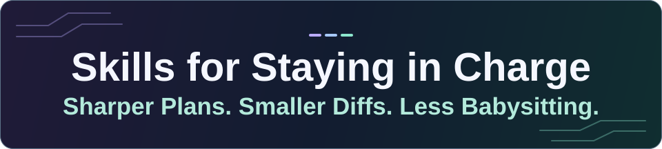

# Skills for Staying in Charge

**Sharper Plans. Smaller Diffs. Less Babysitting.**

Composable skills for coding agents, from a single focused edit to a reviewed pull request.



## Quick start

### 1. Install

Open the section for your coding agent, then install the [companion skills](#companion-skills) and [agent profiles](#agent-profiles) your workflows need. For other agents and install methods, see the [installation reference](#installation-reference).

<details>
<summary><strong>Claude Code</strong></summary>

```sh
npx skills@latest add A-NGJ/skills --global --agent claude-code
```

In Claude Code, run `/explain`.

</details>

<details>
<summary><strong>OpenCode</strong></summary>

```sh
npx skills@latest add A-NGJ/skills --global --agent opencode
```

In OpenCode, ask: `Load the explain skill.`

</details>

<details>
<summary><strong>Pi</strong></summary>

```sh
pi install git:github.com/A-NGJ/skills
```

In Pi, run `/skill:explain`.

</details>

<a name="manual-install"></a>
<details>
<summary><strong>Manual installation</strong></summary>

With Git installed, run the commands below from your project root. The default destination is the project's `.agents/skills/`; use `$HOME/.agents/skills` for a personal install if your coding agent supports it. For [Claude Code](https://code.claude.com/docs/en/skills), use `~/.claude/skills/` or `.claude/skills/`. For [OpenCode](https://opencode.ai/docs/skills/), you can also use `~/.config/opencode/skills/` or `.opencode/skills/`.

```sh
dest="$PWD/.agents/skills"  # change this for a personal or harness-specific install
src="$HOME/src/a-ngj-skills"
mkdir -p "$(dirname "$src")" "$dest"
git clone https://github.com/A-NGJ/skills.git "$src"
for s in "$src"/skills/engineering/*/ "$src"/skills/productivity/*/; do
  ln -s "${s%/}" "$dest/$(basename "$s")"
done
```

Link or copy each whole skill folder so its supporting files stay alongside `SKILL.md`. If you need [companion skills](#companion-skills), copy or link only the ones listed there into the same destination. To try the install, ask your coding agent to load `explain` or use its skill command.

</details>

#### Companion skills

For `grill-with-research` and other workflows that call `grilling`, `domain-modeling`, or `prototype`, install those skills from [mattpocock/skills](https://github.com/mattpocock/skills):

```sh
agent=claude-code  # or opencode, pi, or another supported agent ID
npx skills@latest add mattpocock/skills --global --agent "$agent" --skill grilling domain-modeling prototype
```

Install only those upstream skills with this command. `triage`, `to-tickets`, `research`, `pr`, and `handoff` share names with upstream; don't install both copies. The skills here expect this repo's versions when they call each other.

#### Agent profiles

Install these for `orchestrating`, `research`, and delegated investigation in `managing-projects`. Installing the skill folders alone does not register the profiles.

- **Claude Code and OpenCode:** Clone this repo, then copy the profiles for your harness. If you already cloned it, skip the clone and set `src` to that checkout.

  ```sh
  src="$HOME/src/a-ngj-skills"
  mkdir -p "$(dirname "$src")"
  git clone https://github.com/A-NGJ/skills.git "$src"
  ```

  **Claude Code** (use `.claude/agents` for a project install):

  ```sh
  harness=claude-code
  dest="$HOME/.claude/agents"
  ```

  **OpenCode** (use `.opencode/agents` for a project install):

  ```sh
  harness=opencode
  dest="${XDG_CONFIG_HOME:-$HOME/.config}/opencode/agents"
  ```

  Copy the profiles without replacing any already installed:

  ```sh
  mkdir -p "$dest"
  for profile in "$src/$harness/agents/"*.md; do
    target="$dest/${profile##*/}"
    if [ ! -e "$target" ] && [ ! -L "$target" ]; then
      cp "$profile" "$target"
    fi
  done
  ```


- **Pi:** After installing this repo as a Pi package above, install the [`pi-subagents`](https://github.com/nicobailon/pi-subagents) extension (tested with Pi 1.6.0 and extension 0.90.0):

  ```sh
  pi install npm:pi-subagents@0.90.0
  ```

  Restart Pi and check `/subagents` for `implementation-specialist`, `reviewer`, and `researcher`. The extension discovers the bundled [`pi/agents/`](pi/agents/) profiles automatically.

After installing the profiles, [configure `.model-routing`](#model-routing) in the project where you'll use them.

### 2. Try a skill

Load `explain` as shown above and ask:

> Why can the same file show up as both staged and unstaged in `git status`? Walk me through an example.

Expect a step-by-step example that shows why Git reports both kinds of changes after you edit a file, stage it, and edit it again.

**Optional next steps**

- Using the issue-tracker workflow? Run `setup-engineering-skills` once in that project. See [Issue-tracker setup](#issue-tracker-setup).
- Want skills to delegate work to other agents? See [Delegation and model routing](#delegation-and-model-routing).

## Find a skill

- **Clarify an idea before writing code.** [`grill-with-research`](skills/productivity/grill-with-research/SKILL.md) turns a rough idea into a scoped task with testable acceptance criteria. Use [`roast-me`](skills/productivity/roast-me/SKILL.md) to challenge the choices behind an existing design.
- **Make a focused, reviewable change.** [`clinical-change`](skills/productivity/clinical-change/SKILL.md) keeps the diff focused, [`commit`](skills/engineering/commit/SKILL.md) splits work into atomic commits, and [`pr`](skills/engineering/pr/SKILL.md) writes the pull request body.
- **Decide what to work on next.** [`managing-projects`](skills/engineering/managing-projects/SKILL.md) ranks next actions, [`triage`](skills/engineering/triage/SKILL.md) prepares incoming issues, and [`to-tickets`](skills/engineering/to-tickets/SKILL.md) splits a plan into issues with dependencies.
- **Run an issue through implementation and review.** [`orchestrating`](skills/engineering/orchestrating/SKILL.md) takes one issue to a pull request. If you're moving between sessions yourself, use [`handoff`](skills/productivity/handoff/SKILL.md).

See the [skill reference](#skill-reference) for the full list. Some workflows need [companion skills](#companion-skills).

## Issue-tracker setup

Run [`setup-engineering-skills`](skills/engineering/setup-engineering-skills/SKILL.md) once in the project where you'll use `orchestrating`, `managing-projects`, `triage`, or `to-tickets`. GitHub uses `gh`, GitLab uses `glab`, and a local Markdown tracker under `.scratch/` needs neither tracker CLI.

Use `/setup-engineering-skills` in Claude Code, `/skill:setup-engineering-skills` in Pi, or ask your coding agent to load `setup-engineering-skills` by name. The skill proposes a project description based on the repo and asks you to confirm the setup before writing:

- Project context and links to policy in the root `AGENTS.md` or `CLAUDE.md`.
- `docs/agents/issue-tracker.md` and `docs/agents/domain.md` for the tracker and domain docs.
- `docs/agents/labels.md` if `triage` is installed, and `docs/agents/verification.md` if `orchestrating` is installed.

With `orchestrating` installed, setup adds a **Workflow state** section to `docs/agents/issue-tracker.md`. `orchestrating` won't start without it: it needs to know how to move issues through the project's workflow and how to name issue branches.

## Delegation and model routing

`orchestrating`, `research`, and delegated investigation in `managing-projects` need agent profiles and a `.model-routing` file.

### Agents

The skills expect one active profile per role. Follow the [agent profile installation steps](#agent-profiles), or register the same role IDs in your harness's agent format. `.agents/skills/` provides skill discovery, not subagent dispatch.

Routed dispatch requires explicit model selection for each call, even when an agent has a default. `orchestrating` also requires the ability to run children in the existing issue worktree. If your runtime cannot meet those requirements, use the non-delegating skills.

| Role | Permissions | Used by |
| --- | --- | --- |
| `implementation-specialist` | Plan mode reads only and returns an implementation plan; step mode edits and commits one step in the issue worktree. Cannot dispatch other agents. | `orchestrating` |
| `reviewer` | Read-only. Returns `Accepted`, `Changes Required`, or `Needs clarification`. | `orchestrating` |
| `researcher` | Read-only. Reads files, git history and the web. | `research`, `managing-projects` |

### Model routing

[`model-routing`](skills/engineering/model-routing/SKILL.md) picks the lowest tier that can do the work and explains when a higher tier is needed. Reviewers must meet a minimum tier based on the work they're reviewing. If a route is missing or invalid, dispatch stops rather than silently falling back to another model.

Configure `.model-routing` at the repository's main checkout as a JSON map from agent IDs to `fast`, `standard` and `deep` model references. The model references below are placeholders; agent IDs and reference syntax must match your runtime:

```json
{
  "researcher": {
    "fast": "provider/researcher-fast-model",
    "standard": "provider/researcher-standard-model",
    "deep": "provider/researcher-deep-model"
  }
}
```

Add one entry per agent the coordinator will dispatch, including any built-in agents it uses. See [`model-routing`](skills/engineering/model-routing/SKILL.md) for the required-route gate and the reviewer tier floor. The file is a skill convention, not native runtime configuration, so the runtime must support explicit model selection at dispatch.

### Delegation in Pi

Pi's skill loader does not provide subagents; follow the [Pi agent profile installation steps](#agent-profiles). If you already use a different `subagent` extension, run only one at a time. To keep your existing extension, it must support explicit per-call models, working directories and parallel dispatch; install the Pi profiles in its agent directory if it does not discover package profiles.

Use `pi --list-models` to find available `provider/id` values for `.model-routing` in the **project you're working on**. See [Pi dispatch](skills/engineering/model-routing/PI.md) for how the coordinator passes the selected model and uses the existing issue worktree.

The bundled Pi researcher has file tools only. The coordinator gathers web, git or authenticated evidence within the approved read boundary and passes a sanitized file when needed. The Pi reviewer has a shell to run tests, so its read-only review contract is an instruction, not an OS sandbox. Keep `pi-subagents` artifacts out of the issue worktree (`artifactDir: "session"`, the default) so orchestration's clean-worktree checks pass.

## Installation reference

With `npx skills`, omit `--global` to install into the current project. If your coding agent isn't in Quick start but is listed by `npx skills`, use its `--agent` ID in the Claude Code command.

### Pi install alternatives

To install from a local checkout, run `pi install .` from its root instead of the Git install. The Pi package loads the released skills and makes the profiles available for [optional delegation](#delegation-in-pi). If you want only the skill folders, use `npx skills@latest add A-NGJ/skills --global --agent pi` **instead of** `pi install`, or [install manually](#manual-install).

## Skill reference

Skills are grouped by who they serve. Within each group, **operator-invoked** skills set `disable-model-invocation`, so only you can start them with a slash command. **Model-invoked** skills can also be loaded by the model or by other skills.

### Engineering

**Operator-invoked**

- **[orchestrating](skills/engineering/orchestrating/SKILL.md)**: Plans one issue, runs each step in a fresh specialist session on one shared worktree branch, and opens a pull request. A fresh reviewer who did not write the code checks the work at checkpoints and before the pull request opens. Requires a clean worktree before every dispatch and one active orchestrator per issue.
- **[setup-engineering-skills](skills/engineering/setup-engineering-skills/SKILL.md)**: Captures project context and configures a repo: tracker, labels, domain docs, workflow states. Run once per repo.

**Model-invoked**

- **[commit](skills/engineering/commit/SKILL.md)**: Atomic commits with `type(scope):` subjects.
- **[pr](skills/engineering/pr/SKILL.md)**: Template for pull request bodies: summary, evidence, manual testing, merge danger.
- **[model-routing](skills/engineering/model-routing/SKILL.md)**: Resolves a required repository model route per agent and tier before dispatch.

### Project management

**Model-invoked**

- **[managing-projects](skills/engineering/managing-projects/SKILL.md)**: Ranks priorities, manages dependencies and duplicates, and picks the next issue with a brief for the orchestrator.
- **[triage](skills/engineering/triage/SKILL.md)**: Moves issues and external PRs through triage roles and writes agent-ready briefs.
- **[to-tickets](skills/engineering/to-tickets/SKILL.md)**: Splits a plan into tracer-bullet issues with blocking edges.

### Productivity

**Operator-invoked**

- **[grill-with-research](skills/productivity/grill-with-research/SKILL.md)**: Converges a foggy idea into one fixed-scope work item through grilling, research and prototypes. Works standalone, ending with a converged summary; tracker integrations are optional.
- **[roast-me](skills/productivity/roast-me/SKILL.md)**: A relentless interview that challenges whether each design choice is justified.

**Model-invoked**

- **[handoff](skills/productivity/handoff/SKILL.md)**: Writes a handoff document to the OS temp directory so a fresh session can continue the work.
- **[research](skills/productivity/research/SKILL.md)**: Fans a question out to parallel `researcher` subagents and reports cited findings.
- **[explain](skills/productivity/explain/SKILL.md)**: Explains a topic step by step with one concrete example before the general rule, pitched at the audience.
- **[clinical-change](skills/productivity/clinical-change/SKILL.md)**: Makes an edit that contains nothing beyond what the outcome requires.

### Example workflow

Use only the steps that fit your work:

```text
grill-with-research -> triage / to-tickets -> managing-projects -> orchestrating -> pull request
```

## How this differs from Matt's skills

These skills build on [mattpocock/skills](https://github.com/mattpocock/skills) and install next to the [companion skills](#companion-skills). The rows below describe design differences, so you can pick the version that suits your situation.

| Area | Upstream | This repo |
| --- | --- | --- |
| `triage`, `to-tickets` | Operator-invoked only. | Model-invokable, so `managing-projects` can call them. |
| `handoff` | Operator-invoked only. Free-form document with a suggested-skills section. | Model-invokable. Fixed skeleton, stable path `$TMPDIR/handoff/<skill>-<target>.md`, and a receiving rule that re-reads every linked tracker record before acting. |
| `research` | One background agent writes a Markdown file in the repo. | Fans the question out to parallel `researcher` subagents, each routed to a model tier, and reports cited findings. |
| `pr` | Summary, Evidence and Merge Danger. | Adds a Manual Testing section and an Undo field, which `orchestrating` relies on. |
| `grill-with-docs` and `grill-with-research` | `grill-with-docs` loads `grilling` and `domain-modeling`. | `grill-with-research` adds research and prototypes, and ends in a converged summary. It works without a tracker. |
| `implement-spec` and `orchestrating` | Works a whole spec as a task graph on one integration branch, with parallel implementer subagents in their own worktrees. | Works one issue sequentially on one shared worktree branch, with fresh reviewers, and ends at a pull request. |
| Model selection | Not part of `implement-spec`'s dispatch. | `model-routing` selects a tier for every dispatch from `.model-routing`. |
| Only here | | `model-routing`, `managing-projects`, `clinical-change`, `roast-me`, `explain` |

Use upstream's `implement-spec` when you want parallel throughput. Use `orchestrating` when you want a gated, sequential run.

Upstream `grill-with-docs` stops the model from loading it, so the skills here load `grilling` and `domain-modeling` directly. Run `/grill-with-docs` yourself when you want a grilling session that updates `GLOSSARY.md` and ADRs.

## Repository layout

```text
skills/<group>/<name>/SKILL.md   one folder per skill, grouped engineering/ or productivity/
skills/<group>/<name>/agents/    Codex display metadata (openai.yaml)
claude-code/agents/              Claude Code subagent profiles
opencode/agents/                 OpenCode subagent profiles
pi/agents/                       Pi subagent profiles
                                 Keep role instructions in sync across all three directories.
package.json                    Pi package manifest
skills/engineering/setup-engineering-skills/
                                 templates for GitHub, GitLab and local trackers, labels and domain docs
LICENSE                          MIT license for this repo
LICENSES/                        upstream license texts
GLOSSARY.md                      shared vocabulary for handoff documents and their payloads
```

## Credits and licenses

MIT, see [`LICENSE`](LICENSE).

`triage`, `to-tickets`, `research`, `pr` and `handoff` are adapted from [Matt Pocock's skills](https://github.com/mattpocock/skills) (MIT, see `LICENSES/mattpocock-skills.txt`). Each carries a `metadata.upstream` entry in its frontmatter. The `pr` summary section comes from Dex Horthy's [`show-me`](https://github.com/humanlayer/humanlayer), described in `skills/engineering/pr/CREDITS.md`.
